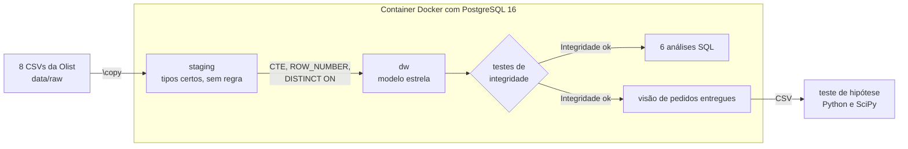
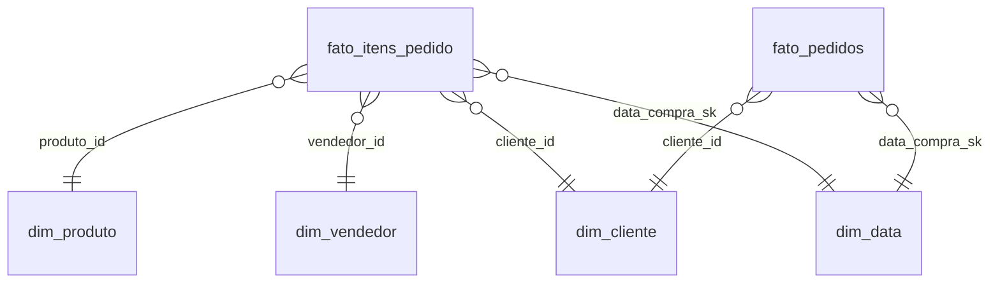
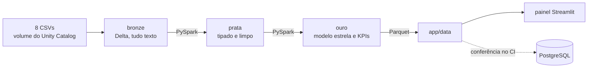

# Olist Logística

[](https://github.com/GuiEller/projeto-logistica/actions/workflows/ci.yml)

**O que mais pesa na satisfação do cliente de um marketplace, e por onde começar a agir?**

Pipeline de dados de ponta a ponta com a base pública da [Olist](https://github.com/olist/work-at-olist-data), cerca de 100 mil pedidos reais de um marketplace brasileiro entre 2016 e 2018.

**[Abrir o painel](LINK_DO_PAINEL)**


O projeto tem duas fases.

| Fase | O que entrega | Status |
|---|---|---|
| 1 | PostgreSQL em Docker, modelo estrela, testes de integridade, 6 análises em SQL e teste de hipótese em Python | concluída |
| 2 | Pipeline em Databricks (PySpark, Delta Lake, arquitetura medalhão), painel em Streamlit, pytest e CI | concluída |

## As ferramentas e o que cada uma faz aqui

| Ferramenta | Como é usada no projeto | Onde está |
|---|---|---|
| **Docker** | Sobe o PostgreSQL 16 e roda o pipeline inteiro com um comando, igual em qualquer máquina | `docker-compose.yml`, `db/init/` |
| **PostgreSQL 16** | Guarda a staging (dado como chegou) e o modelo estrela (dado pronto para análise) | `db/migrations/` |
| **SQL** | Carga com `\copy`, modelagem com CTE e `ROW_NUMBER`, testes de integridade e as 6 análises com window functions | `db/`, `sql/` |
| **Python, pandas e SciPy** | Teste de hipótese (Mann-Whitney U, qui-quadrado, intervalo de confiança) e gráficos | `analise/teste_hipotese.py` |
| **Bash** | Baixa os CSVs da fonte oficial e exporta a base do teste | `scripts/` |
| **Git e GitHub** | Cada entrega nasce de uma Issue e entra por Pull Request | histórico do repositório |
| **Databricks, PySpark e Delta Lake** | O mesmo pipeline refeito na nuvem em camadas bronze, prata e ouro, conferido contra o PostgreSQL | `databricks/` |
| **Parquet** | As tabelas da camada ouro saem como arquivos pequenos que o painel lê sem banco | `app/data/` |
| **Streamlit** | Painel com cinco páginas, cada uma terminando com a conclusão escrita | `app/` |
| **pytest e GitHub Actions** | Testes da lógica em Python, do painel e da conferência entre as camadas, rodando a cada push | `tests/`, `.github/workflows/` |

## O que os dados mostraram

- **O atraso é a alavanca mais concentrada.** Só 6,7% dos pedidos chegam atrasados, mas eles respondem por 32,6% de todas as notas 1 e 2.
- **A nota despenca com o atraso.** A média vai de 4,29 nos pedidos entregues no prazo para 2,27 nos atrasados. Acima de 7 dias de atraso, 79,3% das notas são 1 ou 2.
- **Não é acaso.** O teste de Mann-Whitney U dá p < 0,0001 e efeito grande (rank-biserial de 0,64). Um pedido atrasado tem 6,7 vezes mais chance de nota baixa.
- **O problema tem endereço.** O RJ tem 12,8% dos pedidos e 22,9% dos atrasos. Alagoas atrasa 21,5% das entregas, contra 4,5% em São Paulo.
- **O prazo prometido é folgado demais.** Em média o pedido chega 11,8 dias antes do prometido, o que sugere prazo por região em vez de um prazo nacional.
- **Quase ninguém volta.** Só 3,0% dos clientes compraram mais de uma vez. 18 de 74 categorias somam 81% da receita.


O relatório completo do teste está em [`resultados/teste_hipotese.md`](resultados/teste_hipotese.md).

## Como rodar

Precisa de Docker e Git Bash (ou WSL).

```bash
./scripts/baixar_dados.sh          # baixa os CSVs da Olist para data/raw
docker compose up -d               # sobe o PostgreSQL 16 e roda o pipeline inteiro
docker compose logs -f db          # espere aparecer "Integridade ok"
```

Para consultar o banco, use `docker exec -it olist-db psql -U postgres -d olist`. Para rodar uma análise, use `docker exec -i olist-db psql -U postgres -d olist < sql/analises/05_atraso_vs_avaliacao.sql`.

Teste de hipótese, testes automatizados e painel.

```bash
pip install -r requirements.txt
./scripts/exportar_csv.sh
python analise/teste_hipotese.py
pytest                             # com o container no ar, inclui a conferência contra o Postgres
streamlit run app/Home.py
```

Databricks. Os notebooks de `databricks/` rodam no Databricks Free Edition. Os 8 CSVs vão para o volume `workspace.default.olist_raw`, e os notebooks rodam na ordem `01_bronze`, `02_prata` e `03_ouro`. O último grava os Parquet do painel no volume `workspace.ouro.exportacao`, de onde eles são copiados para `app/data/`.

## Como foi feito





**Staging** (`db/migrations/001` e `002`). Uma tabela por CSV, com os tipos certos e nenhuma regra de negócio. Dinheiro é `NUMERIC`, porque `FLOAT` não fecha a soma ao centavo. A carga é feita com `\copy` e pode rodar de novo sem duplicar linhas.

**Modelo estrela** (`003`). Duas tabelas fato com grãos diferentes e quatro dimensões.

| Tabela | Grão |
|---|---|
| `fato_itens_pedido` | um item vendido (receita) |
| `fato_pedidos` | um pedido (frete, atraso, pagamento, nota) |
| `dim_cliente` | uma pessoa |
| `dim_produto`, `dim_vendedor`, `dim_data` | um produto, um vendedor, um dia |

As duas fatos existem porque, numa tabela só, um pedido com 3 itens contaria o frete e a nota 3 vezes.

Regras de tratamento que mudam o resultado.
- O cliente é a pessoa (`customer_unique_id`). O `customer_id` da Olist muda a cada pedido, e com ele a recompra daria zero.
- Pedido com mais de uma avaliação fica com a mais recente (`DISTINCT ON`).
- Produto sem categoria vira `sem_categoria`, para a receita dele não sumir dos agrupamentos.
- O calendário é gerado como `TIMESTAMP` sem fuso. Com fuso, o horário de verão de 2016 a 2018 pulava dias e quebrava a chave da `dim_data`.

**Testes de integridade** (`sql/testes/integridade.sql`). Rodam ao fim do pipeline e param tudo se uma regra falhar. Receita do modelo igual à da origem até o centavo, nenhum pedido perdido, calendário sem buracos, notas entre 1 e 5, atraso só para pedido entregue e uma linha por cliente.

**Análises** (`sql/analises/`). Cada arquivo responde uma pergunta.

| Arquivo | Pergunta | Técnica |
|---|---|---|
| `01_kpis_mensais` | Como receita, pedidos e ticket evoluíram? | `LAG`, média móvel |
| `02_curva_abc_categorias` | Quais categorias concentram a receita? | `SUM() OVER` acumulado |
| `03_coortes_retencao` | Os clientes voltam? | coortes, `MIN() OVER`, `FILTER` |
| `04_rfm_segmentos` | Como segmentar para CRM? | `NTILE` |
| `05_atraso_vs_avaliacao` | O atraso derruba a nota? | agregação condicional |
| `06_atraso_por_estado` | Onde agir primeiro? | `RANK`, `HAVING` |

**Teste de hipótese** (`analise/teste_hipotese.py`). A nota vai de 1 a 5 e não segue distribuição normal, então o teste t não serve. Usei Mann-Whitney U com correlação rank-biserial para o tamanho do efeito, e qui-quadrado com intervalo de confiança de 95% para a proporção de notas baixas.

### Fase 2. Nuvem, painel e engenharia



**Arquitetura medalhão** (`databricks/`). Cada camada tem um contrato. A bronze guarda o CSV como chegou, para reprocessar sem baixar de novo se uma regra mudar. A prata aplica tipos e as mesmas regras da Fase 1, com dinheiro em `DECIMAL` para a receita fechar ao centavo. A ouro monta as duas fatos e as dimensões e calcula as tabelas do painel. Cada notebook termina com `assert`, então uma camada errada não alimenta a seguinte. O Spark não tem `DISTINCT ON`, então a avaliação mais recente sai de `row_number` numa window.

**Conferência entre camadas** (`tests/test_conferencia.py`). Duas fontes que deveriam ser iguais e não foram conferidas são duas fontes de erro. O teste compara os Parquet da ouro com o PostgreSQL. Total de pedidos, receita e clientes, e mês a mês pedidos, clientes e receita. No CI, um job sobe o Postgres do zero, espera o "Integridade ok" e roda essa conferência.

**Painel** (`app/`). Lê só os Parquet, então não depende de banco e não cai. Cada página responde uma pergunta e termina com a conclusão escrita, porque gráfico sem conclusão deixa a análise para o leitor.

| Página | Pergunta |
|---|---|
| Visão geral | Como o negócio está indo? |
| Vendas | De onde vem a receita? |
| Logística | Onde a entrega falha? |
| Cliente | O atraso derruba a nota? |
| Recomendações | O que fazer primeiro? |

**Testes** (`tests/`). A lógica do teste de hipótese é testada com 14 pedidos inventados de resultado conhecido. Cada página do painel é aberta sem navegador com o `AppTest` do Streamlit. O CI roda tudo a cada push e a cada Pull Request.

## O que muda com 100x mais dados

A base da Olist tem cerca de 100 mil pedidos e cabe numa máquina. Provar escala com ela seria fingir, então esta parte fica no texto.

| Ponto | O que muda |
|---|---|
| Carga | Em vez de recarregar tudo, carga incremental só com os pedidos novos (`MERGE` no Delta) |
| Delta Lake | Particionar por mês, para uma consulta de um período ler só os arquivos daquele mês |
| Chaves | `customer_unique_id` e a chave de data são estáveis, então uma carga nova não quebra as antigas |
| Testes de integridade | Continuam iguais, porque comparam totais e valem para qualquer volume |
| Painel | Já lê Parquet agregado, então o volume bruto nunca chega até ele |
| PostgreSQL local | Deixaria de ser a referência. A conferência passaria a comparar a ouro com a contagem da bronze |

## Recomendações

1. Atacar o atraso no RJ primeiro, que concentra quase um quarto dos atrasos.
2. Prometer prazo por região, e não um prazo nacional.
3. Avisar o cliente antes de atrasar, testando com experimento A/B.
4. Criar um programa de segunda compra para os cerca de 14 mil clientes de alto valor que não voltaram.

O desenho completo do projeto, com o porquê de cada decisão, está no [`SDD.md`](SDD.md).
