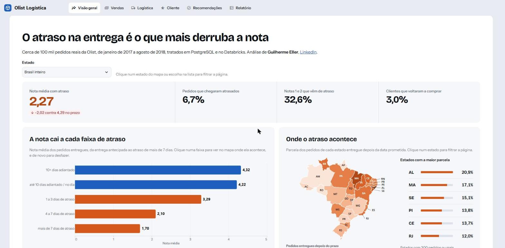
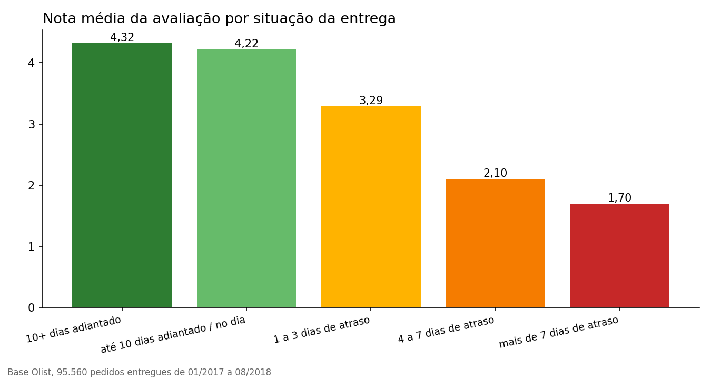
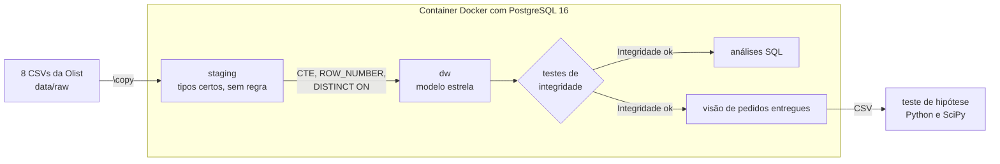
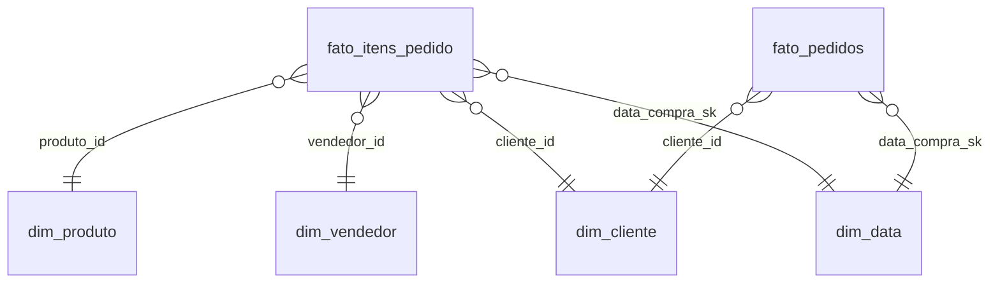
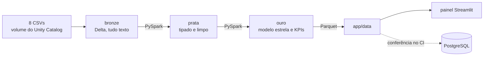

# Olist Logística

[](https://github.com/GuiEller/projeto-logistica/actions/workflows/ci.yml)

**O que mais pesa na satisfação do cliente de um marketplace, e por onde começar a agir?**

A resposta curta é o atraso na entrega. Só 6,7% dos pedidos chegam atrasados, mas eles respondem por 32,6% de todas as notas 1 e 2.

Peguei cerca de 100 mil pedidos reais da [Olist](https://github.com/olist/work-at-olist-data), um marketplace brasileiro, e fiz o caminho inteiro de quem trabalha com dado. Baixei os arquivos, tratei, modelei no PostgreSQL, refiz o pipeline no Databricks, conferi uma camada contra a outra e publiquei um painel que abre com um clique.

**[Abrir o painel](https://projeto-logistica.streamlit.app/)**



Feito por Guilherme Eller. Se quiser conversar sobre o projeto, me chame no [LinkedIn](https://www.linkedin.com/in/guilherme-eller/).

## O que os dados mostraram

- **O atraso pesa mais do que o tamanho dele sugere.** Só 6,7% dos pedidos chegam atrasados, e esses pedidos geram 32,6% de todas as notas 1 e 2.
- **A nota cai rápido.** Quem recebe no prazo dá 4,29 em média. Quem recebe atrasado dá 2,27. Com mais de 7 dias de atraso, 79,3% das notas são 1 ou 2.
- **Não foi acaso.** O teste de Mann-Whitney U dá p abaixo de 0,0001, com efeito grande (rank-biserial de 0,64). Um pedido atrasado tem 6,7 vezes mais chance de receber nota baixa.
- **O problema tem endereço.** O RJ tem 12,8% dos pedidos e 22,9% dos atrasos. Os mesmos 124 vendedores atrasam 12,2% dos pedidos que enviam para o RJ e 4,4% dos que enviam para SP. O gargalo está no caminho até o cliente, e cobrar o vendedor não resolveria.
- **O prazo prometido não acompanha o risco de cada região.** O pedido médio chega 11,8 dias antes do prometido. O Nordeste tem quase a mesma folga do Sudeste (11,2 contra 11,5 dias), mas atrasa 12,8% das entregas contra 6,1%.
- **Quase ninguém volta.** Só 3,0% dos clientes compraram mais de uma vez. E 18 das 74 categorias somam 81% da receita.



Cada número do painel diz qual é a base dele. O mesmo atraso aparece como 6,7% entre os pedidos entregues e avaliados e como 6,8% entre todos os entregues, e as duas contas estão certas, cada uma na sua base.

O relatório formal, com metodologia, conferências e limites da análise, está em [`resultados/relatorio.md`](resultados/relatorio.md). O teste estatístico está em [`resultados/teste_hipotese.md`](resultados/teste_hipotese.md).

## As ferramentas e para que usei cada uma

| Ferramenta | Para que usei | Onde está |
|---|---|---|
| **Docker** | Sobe o PostgreSQL 16 e roda o pipeline inteiro com um comando, igual em qualquer máquina | `docker-compose.yml`, `db/init/` |
| **PostgreSQL 16** | Guarda a staging (o dado como chegou) e o modelo estrela (o dado pronto para análise) | `db/migrations/` |
| **SQL** | Carga com `\copy`, modelagem com CTE e `ROW_NUMBER`, testes de integridade e 13 análises com window functions | `db/`, `sql/` |
| **Python, pandas e SciPy** | O teste de hipótese (Mann-Whitney U, qui-quadrado, intervalo de confiança) e os gráficos do relatório | `analise/` |
| **Bash** | Baixa os CSVs da fonte oficial e exporta a base do teste | `scripts/` |
| **Git e GitHub** | Cada entrega nasce de uma Issue e entra por Pull Request | histórico do repositório |
| **Databricks, PySpark e Delta Lake** | Refaz o mesmo pipeline na nuvem, em camadas bronze, prata e ouro, e confere o resultado contra o PostgreSQL | `databricks/` |
| **Parquet** | As tabelas da camada ouro viram arquivos pequenos que o painel lê sem precisar de banco | `app/data/` |
| **Streamlit** | O painel, com seis páginas. Cada uma termina com a conclusão escrita | `app/` |
| **pytest e GitHub Actions** | Testam a lógica em Python, o painel e a conferência entre as camadas a cada push | `tests/`, `.github/workflows/` |

O projeto teve duas fases. Na primeira, PostgreSQL em Docker, modelo estrela, testes de integridade, análises em SQL e o teste de hipótese. Na segunda, o pipeline no Databricks, o painel em Streamlit, o pytest e o CI.

## Como rodar

Precisa de Docker e Git Bash (ou WSL).

```bash
./scripts/baixar_dados.sh          # baixa os CSVs da Olist para data/raw
docker compose up -d               # sobe o PostgreSQL 16 e roda o pipeline inteiro
docker compose logs -f db          # espere aparecer "Integridade ok"
```

Para consultar o banco, use `docker exec -it olist-db psql -U postgres -d olist`. Para rodar uma análise, use `docker exec -i olist-db psql -U postgres -d olist < sql/analises/05_atraso_vs_avaliacao.sql`.

Para rodar o teste estatístico, os testes automatizados e o painel no seu computador.

```bash
pip install -r requirements.txt
./scripts/exportar_csv.sh
python analise/teste_hipotese.py
pytest                             # com o container no ar, inclui a conferência contra o Postgres
streamlit run app/Home.py
```

Os notebooks de `databricks/` rodam no Databricks Free Edition. Os 8 CSVs vão para o volume `workspace.default.olist_raw`, e os notebooks rodam na ordem `01_bronze`, `02_prata` e `03_ouro`. O último grava os Parquet do painel no volume `workspace.ouro.exportacao`, de onde eles são copiados para `app/data/`.

## Como foi feito

### Fase 1. PostgreSQL e SQL





**Staging** (`db/migrations/001` e `002`). Uma tabela por CSV, com os tipos certos e nenhuma regra de negócio. Dinheiro é `NUMERIC`, porque `FLOAT` não fecha a soma ao centavo. A carga usa `\copy` e pode rodar de novo sem duplicar linhas.

**Modelo estrela** (`003`). Duas tabelas fato com grãos diferentes e quatro dimensões.

| Tabela | Grão |
|---|---|
| `fato_itens_pedido` | um item vendido (receita) |
| `fato_pedidos` | um pedido (frete, atraso, pagamento, nota) |
| `dim_cliente` | uma pessoa |
| `dim_produto`, `dim_vendedor`, `dim_data` | um produto, um vendedor, um dia |

Separei as duas fatos porque, numa tabela só, um pedido com 3 itens contaria o frete e a nota 3 vezes.

Quatro regras de tratamento mudam o resultado, e por isso ficam escritas aqui.
- O cliente é a pessoa (`customer_unique_id`). O `customer_id` da Olist muda a cada pedido, e com ele a recompra daria zero.
- Pedido com mais de uma avaliação fica com a mais recente (`DISTINCT ON`).
- Produto sem categoria vira `sem_categoria`, para a receita dele não sumir dos agrupamentos.
- O calendário é gerado como `TIMESTAMP` sem fuso. Com fuso, o horário de verão de 2016 a 2018 pulava dias e quebrava a chave da `dim_data`.

A análise cobre de janeiro de 2017 a agosto de 2018. Fora dessa janela há poucos pedidos, e a tendência ficaria distorcida.

**Testes de integridade** (`sql/testes/integridade.sql`). Rodam no fim do pipeline e param tudo se uma regra falhar. A receita do modelo tem de ser igual à da origem até o centavo. Nenhum pedido pode se perder, o calendário não pode ter buracos, as notas ficam entre 1 e 5, atraso só existe para pedido entregue e cada cliente aparece em uma linha.

**Análises** (`sql/analises/`). Cada arquivo responde uma pergunta. As seis primeiras são as perguntas de negócio.

| Arquivo | Pergunta | Técnica |
|---|---|---|
| `01_kpis_mensais` | Como receita, pedidos e ticket evoluíram? | `LAG`, média móvel |
| `02_curva_abc_categorias` | Quais categorias concentram a receita? | `SUM() OVER` acumulado |
| `03_coortes_retencao` | Os clientes voltam? | coortes, `MIN() OVER`, `FILTER` |
| `04_rfm_segmentos` | Como segmentar para CRM? | `NTILE` |
| `05_atraso_vs_avaliacao` | O atraso derruba a nota? | agregação condicional |
| `06_atraso_por_estado` | Onde agir primeiro? | `RANK`, `HAVING` |

As análises `07` a `13` geram as tabelas que o painel e o relatório usam, como a nota por dia de atraso, a entrega por região, o mesmo vendedor em destinos diferentes, a recompra e o filtro por estado.

**Teste de hipótese** (`analise/teste_hipotese.py`). A nota vai de 1 a 5 e não segue distribuição normal, então o teste t não serve. Usei Mann-Whitney U, com correlação rank-biserial para medir o tamanho do efeito, e qui-quadrado, com intervalo de confiança de 95%, para a proporção de notas baixas.

### Fase 2. Nuvem, painel e engenharia



**Arquitetura medalhão** (`databricks/`). Cada camada tem um contrato. A bronze guarda o CSV como chegou, para eu reprocessar sem baixar de novo se uma regra mudar. A prata aplica os tipos e as mesmas regras da Fase 1, com dinheiro em `DECIMAL` para a receita fechar ao centavo. A ouro monta as duas fatos e as dimensões e calcula as tabelas do painel. Cada notebook termina com `assert`, então uma camada errada não alimenta a seguinte. O Spark não tem `DISTINCT ON`, então a avaliação mais recente sai de um `row_number` numa window.

**Conferência entre camadas** (`tests/test_conferencia.py`). Duas fontes que deveriam ser iguais e nunca foram comparadas são duas fontes de erro. O teste compara os Parquet da ouro com o PostgreSQL. Confere o total de pedidos, a receita e os clientes, e depois pedidos, clientes e receita mês a mês. No CI, um job sobe o Postgres do zero, espera o "Integridade ok" e roda essa conferência.

**Um erro que virou correção.** Na primeira execução da ouro no Serverless, a exportação quebrou com `Object of type PlanMetrics is not JSON serializable`. O `toPandas()` guarda métricas da execução em `df.attrs`, e o pandas tenta gravar esse campo dentro do Parquet. A ouro agora limpa o `attrs` antes de gravar.

**Painel** (`app/`). Lê só os Parquet e a malha dos estados do IBGE, então não depende de banco nem de rede e não cai. Clicar num estado do mapa filtra as páginas Visão geral, Logística e Cliente, e clicar de novo desfaz o filtro. Cada página responde uma pergunta e termina com a conclusão escrita, porque gráfico sem conclusão deixa a análise para o leitor. Os textos das conclusões são montados a partir dos números, para nunca divergirem deles. Números, eixos e meses saem no padrão brasileiro pelo `locale` do tema do Altair.

| Página | Pergunta |
|---|---|
| Visão geral | Qual é a descoberta principal? |
| Vendas | De onde vem a receita? |
| Logística | Onde a entrega falha? |
| Cliente | O atraso derruba a nota? |
| Recomendações | O que fazer primeiro? |
| Relatório | Como cada número foi calculado e quanto cada ação rende? |

**Testes** (`tests/`). A lógica do teste de hipótese é testada com 14 pedidos inventados de resultado conhecido. Cada página do painel é aberta sem navegador, com o `AppTest` do Streamlit. O CI roda tudo a cada push e a cada Pull Request.

## O que muda com 100x mais dados

A base da Olist tem cerca de 100 mil pedidos e cabe numa máquina. Provar escala com ela seria fingir, então esta parte fica só no texto.

| Ponto | O que muda |
|---|---|
| Carga | Em vez de recarregar tudo, carga incremental só com os pedidos novos (`MERGE` no Delta) |
| Delta Lake | Particionar por mês, para uma consulta de um período ler só os arquivos daquele mês |
| Chaves | `customer_unique_id` e a chave de data são estáveis, então uma carga nova não quebra as antigas |
| Testes de integridade | Continuam iguais, porque comparam totais e valem para qualquer volume |
| Painel | Já lê Parquet agregado, então o volume bruto nunca chega até ele |
| PostgreSQL local | Deixaria de ser a referência. A conferência passaria a comparar a ouro com a contagem da bronze |

## O que eu faria primeiro

1. Rever a entrega até o cliente no RJ, que concentra quase um quarto dos atrasos. Transportadora e rota são os suspeitos, porque o mesmo vendedor atrasa bem menos para SP.
2. Prometer prazo por região, e não um prazo nacional.
3. Avisar o cliente antes do primeiro dia de atraso, e validar o aviso com um experimento A/B.
4. Criar um programa de segunda compra para os cerca de 14 mil clientes de alto valor que não voltaram.

O desenho completo do projeto, com o porquê de cada decisão, está no [`SDD.md`](SDD.md).
