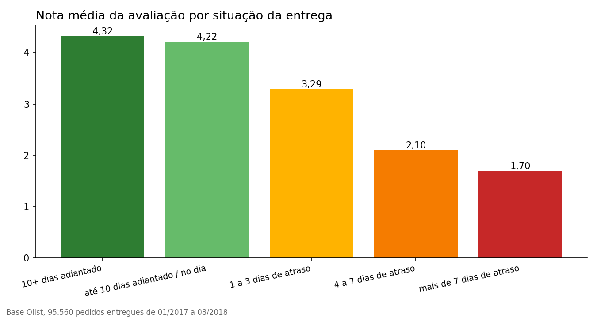
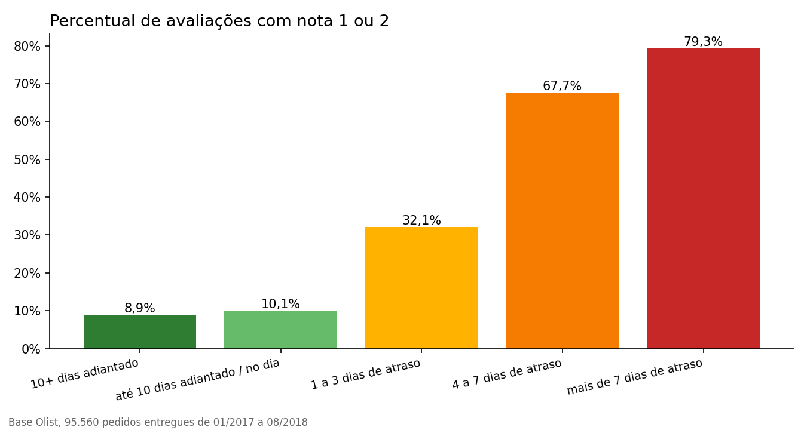

# Teste de hipótese, atraso na entrega x avaliação do cliente

Base com 95.560 pedidos entregues e avaliados, de 01/2017 a 08/2018. 6,7% chegaram depois da data prometida.

## H1. Pedidos atrasados recebem notas menores

Teste de Mann-Whitney U unilateral, porque a nota é ordinal (1 a 5) e não segue distribuição normal.

| | Atrasados | No prazo |
|---|---|---|
| Pedidos | 6.378 | 89.182 |
| Nota média | 2,27 | 4,29 |
| Nota mediana | 1 | 5 |

U = 102.901.002, p-valor < 0,0001. Tamanho de efeito pela correlação rank-biserial de 0,64, o que é considerado efeito grande (acima de 0,5). Com alfa de 5%, rejeitamos H0.

## H2. Atraso aumenta a chance de nota 1 ou 2

Nota 1 ou 2 em 62,4% dos atrasados contra 9,2% dos entregues no prazo. Diferença de 53,2 pontos percentuais (IC 95% de 52,0 a 54,4). Um pedido atrasado tem 6,7 vezes mais chance de receber nota baixa.

Qui-quadrado = 15.075,5, 1 grau de liberdade, p-valor < 0,0001. Rejeitamos H0.

## Leitura de negócio

Os atrasados são só 6,7% dos pedidos, mas respondem por 32,6% de todas as notas 1 e 2 da base. Atacar o atraso é a alavanca mais concentrada que existe para melhorar a reputação.

Observação. O teste mostra associação forte, não prova causalidade sozinho. Ainda assim, a relação cresce de forma consistente com o tamanho do atraso (tabela abaixo), o que reforça a leitura.

| Situação da entrega | Pedidos | Nota média | Nota 1 ou 2 |
|---|---|---|---|
| 10+ dias adiantado | 61.270 | 4,32 | 8,9% |
| até 10 dias adiantado / no dia | 27.912 | 4,22 | 10,1% |
| 1 a 3 dias de atraso | 1.851 | 3,29 | 32,1% |
| 4 a 7 dias de atraso | 1.748 | 2,10 | 67,7% |
| mais de 7 dias de atraso | 2.779 | 1,70 | 79,3% |

